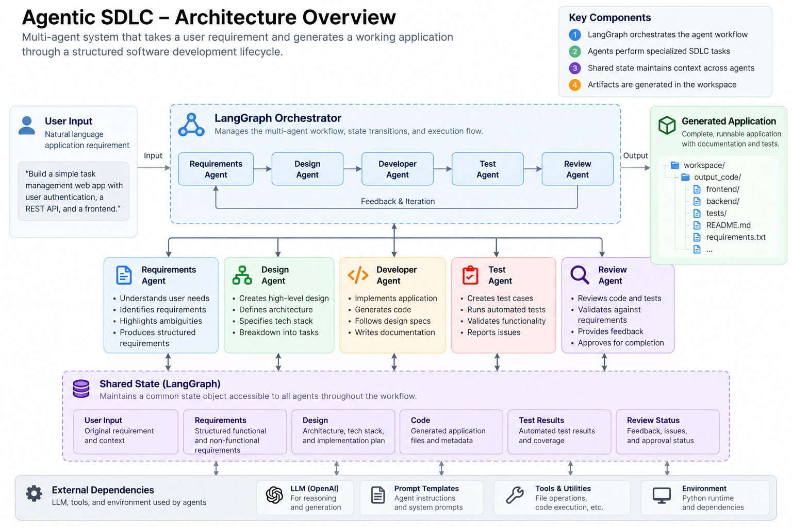

# Agentic SDLC Harness

LangGraph harness for an agentic software development lifecycle workflow.
Stage 1 converts natural-language requirements into structured user stories using OpenAI.
Stage 2 pauses ambiguous runs for human clarification and resumes from persistent checkpoints.
Stage 3 optionally converts completed requirements into a reviewable technical design.
Stage 4 optionally converts that design into a validated development task plan.
Stage 5 optionally generates application files one task at a time without executing them.
Stage 6 runs approved local pytest and records actual test results.

## Architecture Overview



## Setup

```bash
python -m venv .venv
source .venv/bin/activate
pip install -r requirements.txt
cp .env.example .env
```

Set `OPENAI_API_KEY` and `OPENAI_MODEL` in `.env`. Existing environment variables
take precedence. Use a model that supports structured outputs; the example uses
`gpt-4.1-mini`. Never commit credentials. Python 3.11 or later is required.

## Run

```bash
python run.py start --requirement "Build a URL shortener service"
```

The CLI prints a JSON report with `run_id`, `thread_id`, `status`, `requirements`,
and clarification history. Each start creates a unique run ID that remains the
LangGraph thread ID throughout the run. The Stage 1 `--requirement` shorthand still works.

Ambiguous requirements produce `status: "paused"` and `open_questions`. The command
exits immediately without prompting for terminal input, making it suitable for scripts.
Answer the questions in plain text and resume using the returned run ID:

```bash
python run.py resume --run-id <run_id> --answers "Public users need to shorten URLs and follow short links."
```

Answers are stored with the questions and passed back to the Requirements Agent
alongside the original request. The agent regenerates validated requirements. If
blocking ambiguity remains, the same run pauses again. To reject a paused run:

```bash
python run.py resume --run-id <run_id> --reject
```

Rejection ends the run with `rejected`, preserves the draft, and makes no further
LLM call. Completed, failed, rejected, and unknown runs cannot be resumed with
these commands. Blank answers are rejected without consuming the pause.

Under `workspace/runs/<run_id>/`, `checkpoints.sqlite` stores durable graph state,
`requirements.json` stores the latest requirements object, and `status.json` stores
the latest CLI report. Resume works from another process using the same local files;
legacy Stage 1 artifacts without checkpoints cannot be resumed. A failed regeneration
clears requirements in state and writes `null` over the old requirements artifact.
Checkpoint history retains previous drafts and answers. Run artifacts are ignored
by Git; keep them private and do not edit checkpoints manually.

Exit codes: 0 for completion, pause, or rejection; 1 for workflow, storage, or invalid
resume errors; 2 for invalid CLI arguments. Workflow failures appear in the JSON
report; CLI/storage errors go to stderr. No generated commands are executed.
Use one CLI operation at a time per run; this MVP does not coordinate concurrent resumes.

## Requirements Agent

Instructions live in `prompts/requirements.md` and are loaded relative to the
repository, independently of the working directory. Pydantic models in
`models/requirements.py` validate the OpenAI SDK structured output.

The result includes `summary`, `user_stories`, `non_functional_requirements`,
`assumptions`, `open_questions`, and `requires_human_clarification`. Each story
has an ID, title, `as_a`, `i_want`, `so_that`, MoSCoW priority (`must`, `should`,
`could`, `wont`), and acceptance criteria with `given`, `when`, and `then` fields.
Blocking ambiguity produces targeted questions rather than invented requirements.

The graph starts with `pending` and stores validated data in
`state["requirements"]`. Routing after the requirements node is conditional:

- `requirements_complete` goes to `END` by default, or to the Design Agent when
  the run was started with `--through design`.
- `needs_human_clarification` goes through a pause node, which persists `paused`,
  and then a clarification node calls LangGraph `interrupt()` with the open questions.
- `Command(resume={"answers": ...})` continues the clarification node, records the
  answers, changes status to `pending`, and routes back to requirements.
- `Command(resume={"reject": true})` changes status to `rejected` and routes to `END`.
- `failed` for empty input, missing configuration, prompt loading errors, invalid
  or incomplete output, model refusals, or API errors. Requirements are cleared
  and a safe message is stored in `state["error"]`.

## Design Agent

Opt in to execute through design:

```bash
python run.py start --through design --requirement "Build a URL shortener with create and redirect endpoints using FastAPI and SQLite"
```

The existing shorthand also works:

```bash
python run.py --requirement "Build a URL shortener service" --through design
```

`--through` defaults to `requirements`, preserving Stage 1 and Stage 2 behavior.
`--stop-after` is an alias for `--through`; both accept `requirements`, `design`, `planning`, `development`, or `qa`.
It is stored in the checkpoint. If a design-enabled run pauses, answer it with
the usual resume command; no need to re-enter requirements or repeat the option:

```bash
python run.py start --through design --requirement "Build a secure and scalable web application"
python run.py resume --run-id <returned_run_id> --answers "Users create short URLs and follow them to the original URLs."
```

Selecting `--through design` authorizes technical design once requirements are
complete; this MVP has no separate requirements approval interrupt. Blocking
clarification still pauses execution. Rejection and requirements failures never
run design. The Design Agent independently validates structured requirements and
refuses inputs flagged as requiring clarification.

The agent reads `prompts/design.md`, uses the same `.env` and OpenAI structured
output integration, and receives the structured requirements, original request,
and clarification history from state. It respects explicit technology constraints.
FastAPI, SQLite, and pytest are the URL shortener defaults when unspecified;
inferred choices are documented as assumptions, with tradeoffs recorded as risks.

`models/design.py` defines the `DesignOutput` schema: architecture summary,
technology stack, components, API endpoints (method/path/request/response/errors),
data models, non-functional design, ordered implementation plan, assumptions,
risks, and story traceability. Traceability must contain every story exactly once
and one coverage explanation per acceptance criterion. Stage 6.5 preserves failed
attempts and uses up to two bounded correction retries before a safe stop. Structural validation
does not establish technical correctness; review the design before implementation.

Clear requirements route `requirements -> design -> END`, ending with
`design_complete`. Ambiguous ones route through `pause -> clarification`, then
return to `requirements` after answers, and only then to design if clear. Design
errors end with `failed`, preserve the structured requirements, and clear design.

Design-enabled completed runs additionally save `design.json` in the existing
`workspace/runs/<run_id>/` directory. The CLI report and `status.json` also include
`design` and `through`. A paused or rejected run has no design artifact. SQLite
stores both the stage choice and design state with the original thread ID.
Completed requirements-only runs cannot be upgraded using `resume`; start a new
design-enabled run instead. Runs paused before Stage 3 remain requirements-only.

## Planning Agent

Run the URL shortener through planning:

```bash
python run.py start --through planning --requirement "Build a URL shortener using FastAPI and SQLite with endpoints to create short URLs and redirect visitors"
# Equivalent option, also supported with the legacy --requirement shorthand:
python run.py --requirement "Build a URL shortener service" --stop-after planning
```

The final stage is saved in the checkpoint. A paused planning-enabled run resumes
with the existing `resume --run-id ... --answers ...` command, without repeating
requirements, design, or the stage option. Planning uses `RequirementsOutput` and
`DesignOutput` already in state. It does not regenerate the design. Completed
requirements-only or design-only runs cannot be extended with `resume`; start a
new run with the desired final stage.

`prompts/planning.md` describes task decomposition, prerequisites, acceptance
checks, and artifact ownership. `models/planning.py` defines `ImplementationTask`
and `ExecutionPlan`. A task has an ID, title, description, related story IDs,
dependency task IDs, expected file artifacts, acceptance checks, and status.
Lifecycle statuses are `pending`, `ready`, `in_progress`, `completed`, `blocked`,
and `failed`. Since this stage executes nothing, initial model claims of task
completion are discarded; Python sets root tasks to `ready` and dependent tasks
to `blocked` until their prerequisites complete.

`orchestrator/task_plan.py` validates unique task IDs, existing and non-repeated
prerequisites, no self-dependencies or cycles, known story IDs, coverage of all
non-`wont` stories, and exclusion of `wont` scope. Acceptance checks must be
nonempty. File paths must be normalized under `workspace/output_code/`. Each
file has one task owner unless `shared_artifacts` explicitly names every owner
and provides a nonempty justification. Such justification is reviewable text;
its technical adequacy still needs human review.

A stable Kahn topological sort uses only Python's standard library. It returns
`ordered_task_ids` and sorts the task list accordingly. `ready_task_ids` and
`blocked_task_ids` reflect dependency completion, not position in the list.
Independent roots can be ready together. LangGraph's workflow and the plan's
execution DAG are separate: LangGraph runs agents; it does not run these tasks.

A minimal illustrative plan for a single story looks like:

```json
{
  "tasks": [{
    "task_id": "TASK-001",
    "title": "Implement URL mapping storage",
    "description": "Persist short codes and original URLs in SQLite.",
    "related_user_story_ids": ["US-001"],
    "dependencies": [],
    "expected_artifacts": ["workspace/output_code/app/storage.py"],
    "acceptance_checks": ["A stored short code retrieves its original URL."],
    "status": "ready"
  }],
  "shared_artifacts": [],
  "ordered_task_ids": ["TASK-001"],
  "ready_task_ids": ["TASK-001"],
  "blocked_task_ids": []
}
```

For planning-enabled runs, clear requirements route through
`requirements -> design -> planning -> END` and finish as `planning_complete`.
Ambiguity pauses before design; failed requirements/design and rejection never
reach planning. The Planning Agent independently checks input schemas, completed
design status, and the clarification flag. Planning errors end as `failed` with
`plan: null`, while preserving requirements and design. Invalid plans are rejected
without automatically retrying or running any tasks.

A successful run adds `plan.json` beside `requirements.json`, `design.json`,
`status.json`, and `checkpoints.sqlite` in `workspace/runs/<run_id>/`. The report
and checkpoint include `plan`. Failed, paused, or rejected planning-enabled runs
do not create a plan artifact. These files remain ignored by Git. Planned artifact
paths are metadata only: Stage 4 writes no application files and executes no code
or generated shell commands during planning.

## Developer Agent

Generate an application through the development stage:

```bash
python run.py start --stop-after development --requirement "Build a URL shortener using FastAPI and SQLite. POST /shorten creates short URLs; GET /{short_code} redirects visitors."
```

Existing requirements/design/planning commands retain their behavior. This opt-in
runs `requirements -> design -> planning -> development_prepare`, then loops
`development_select -> developer -> development_select`. Requirements still pause
for clarification before design. Invalid or failed planning never reaches development.

The Developer Agent receives the existing structured requirements, design, plan,
current task, previous attempt results, and managed file contents. Each selection
marks one ready task `in_progress` in a checkpoint. Its dependencies must all be
`completed`. After output/schema/acceptance-mapping/path validation, Python syntax
parsing, and successful persistence, that task becomes `completed` and readiness
is recalculated. Failed tasks become `failed`; their dependents remain `blocked`.
Completion is a static implementation result, not a claim that tests passed.

Application files are generated under `workspace/output_code/<run_id>/`, separate
from the harness. Plan paths such as `workspace/output_code/app/main.py` map to
`workspace/output_code/<run_id>/app/main.py`. A task can only return its declared
artifacts. The updated planner explicitly includes standalone requirements.txt,
README.md, package files, and pytest tests for the URL shortener demo.

`orchestrator/file_writer.py` rejects absolute/traversal paths, symlinks, unsafe
names, sensitive filenames, unsupported extensions, hardlinked destinations, and
unrelated or externally modified files. It validates all changes before writing,
limits file/output sizes, and atomically replaces individual files. A run-local
`.developer-state.json` journal and task receipts allow interrupted multi-file
writes to be completed safely on replay. It is not an atomic transaction across
all files: a failed task may leave partial files, but is never marked completed.
A run-local lock prevents simultaneous writer operations. Do not edit generated
files or control files while the workflow is active. Receipts and hashes detect
external edits; this local MVP is not a sandbox against hostile local processes.

Each task is a separate LangGraph checkpoint. `development_results.json` in
`workspace/runs/<run_id>/` records attempts, structured outputs, generated paths,
and whether persistence completed. `plan.json` reflects task status changes.
`status.json` and SQLite retain the run's development progress. Receipts store
full output for replay. None of these artifacts are committed by default.

Generation is bounded to 20 task attempts per invocation (set
`--development-budget 1..50` on start) and three attempts per task across retries.
On task failure or budget exhaustion, `development_gate` interrupts and the CLI
returns `paused`. Retry explicitly using the same run:

```bash
python run.py resume --run-id <run_id> --retry-development
# Or end the run while retaining its artifacts:
python run.py resume --run-id <run_id> --reject
```

Retry preserves completed tasks and resets failed tasks to pending. The per-call
budget resets; per-task attempt counts do not. If a process stops between developer
checkpoints, `--retry-development` replays pending development nodes using file
receipts rather than regenerating a successfully persisted task. A third failed
attempt requires a new run after review. Completed runs cannot be resumed.

No generated code, imports, tests, dependency installation, or model-suggested
commands are executed by the harness. Acceptance mapping is the LLM's explanation,
not independent verification. Syntax validation does not establish runtime
correctness, security, or completeness. During development, QA has not yet run. The Review Agent is not implemented.
`pytest.ini` restricts harness test discovery to tests/ so generated tests are
never collected by a harness pytest run. Pass `tests` explicitly when testing a
generated app inside this repository. Review the generated code and its README
before manually running it in an isolated
local environment. For the demo's app/main.py entry point:

```bash
cd workspace/output_code/<run_id>
python3 -m venv .venv
source .venv/bin/activate
python -m pip install -r requirements.txt
python -m pytest -q tests
python -m uvicorn app.main:app --host 127.0.0.1 --port 8000
```

In another terminal:

```bash
curl -i -X POST http://127.0.0.1:8000/shorten -H 'Content-Type: application/json' -d '{"url":"https://example.com"}'
curl -i http://127.0.0.1:8000/<returned_short_code>
curl -i http://127.0.0.1:8000/nonexistent-code
```

Use the request field and entry point in the actual generated README if its
approved design differs. Runtime commands above are for manual use only.

## QA Agent — local MVP

Generate through QA with the existing workflow:

```bash
python run.py --requirement "Build a URL shortener using FastAPI and SQLite with POST /shorten and GET /{short_code}." --stop-after qa
```

Generation does not grant permission to execute code. QA initially returns
`qa_blocked`. Review the generated application, tests, conftest files, and dependency
list. Prepare a dedicated per-run environment yourself, then authorize execution:

```bash
python3.12 -m venv workspace/qa_venvs/<run_id>
# Only after reviewing and approving the dependency list:
workspace/qa_venvs/<run_id>/bin/python -m pip install -r workspace/output_code/<run_id>/requirements.txt
workspace/qa_venvs/<run_id>/bin/python -m pip install pytest httpx
python run.py qa --run-id <run_id> --authorize-local-execution
```

`QA_LOCAL_PYTHON` can name that environment's absolute bin/python path. It must
be the dedicated `workspace/qa_venvs/<run_id>/` environment, with system site
packages disabled. The harness never installs dependencies. The `qa` command
reuses the run's thread/checkpoint and completed development state. Calling it
without the approval flag blocks execution. Actionable pytest failures may trigger the bounded source-repair loop below.

**Local pytest is not sandboxed. A virtual environment is NOT a security boundary.**
Only run trusted, reviewed code: it can access your account's files and network.
The runner filters inherited environment variables, copies managed source into a
disposable working directory, and invokes only `python -m pytest -q` using
`subprocess.run(shell=False)` with a 60-second timeout. It captures at most 32 KiB
per output stream and applies POSIX CPU/file-size limits. It does not contain
hostile code or reliably terminate processes spawned by tests. Generated databases,
.venv, and control files are not copied. A harness-owned pytest.ini overrides
project test options, and third-party pytest plugin autoloading is disabled.

`qa_results.json`, state, and `status.json` record `status`, `exit_code`, test counts,
`duration_seconds`, `error_summary`, `test_output`, and acceptance criteria.
A zero exit code requires actual non-skipped tests in pytest's final summary.
Exit five or an unrecognized/missing summary is blocked, not success. Failures and
timeouts cannot pass. Counts are taken from the final summary, not an LLM.

There is no test-to-criterion mapping in this MVP: every acceptance criterion is
`not_verified`, even when the suite passes. `qa_passed` describes the test suite
only; business acceptance, review, and final approval remain pending. The QA node
runs after completed development, preserving existing clarification, recovery,
and checkpoint routing. It never marks the entire SDLC completed. CLI exit codes
are 0 for qa_passed, 1 for qa_failed, and 3 for qa_blocked.

## Design correction and safe recovery (Stage 6.5)

Design generation now routes through a separate deterministic validator before
planning or later stages. Existing CLI commands remain unchanged. Each run allows
one initial design attempt and **at most two correction retries**:

```text
design -> design_validator
  valid                       -> planning (or END when stopping at design)
  retryable, budget remaining -> design_retry -> design
  non-retryable or exhausted  -> design_safe_stop -> END
```

The retry node increments `design_retry_count` in a checkpoint **before** the next
network request. SDK transport retries are disabled for design generation, so
there are at most three design generation requests. The correction context includes
the original structured requirements, previous candidate when available, exact
validation issues, and instructions to preserve valid sections while fixing defects.
No requirements or design scope is silently replaced to make validation pass.

`orchestrator/design_validation.py` checks the Pydantic contract, every story ID
exactly once (including excluded stories), criterion coverage count and nonempty
explanations, declared component/endpoint/data-model references, component
references in dependencies, unique design element names, and nonempty mandatory
content. It also checks explicit HTTP method/path requirements and recognized
positive technology choices (FastAPI, SQLite, PostgreSQL, Django, Flask). It does
not infer all possible architecture constraints from natural language or prove
that prose explanations satisfy business requirements.

New canonical traceability references are `component:<name>`,
`endpoint:<METHOD path>`, and `data_model:<name>`. Existing descriptive references
are accepted only when composed of declared names and recognized labels.

Each validation issue contains `code`, `field`, `message`, `retryable`, and
`affected_story_ids`. For example:

```json
{
  "code": "MISSING_STORY",
  "field": "story_traceability",
  "message": "Add exactly one traceability entry for US-005.",
  "retryable": true,
  "affected_story_ids": ["US-005"]
}
```

Schema-invalid or incomplete model output and traceability/reference defects are
retryable. Missing credentials/prompts, permissions, API quota/connectivity,
unsupported SDK/schema requests, refusals, and credential-like output are
non-retryable: correcting a design cannot resolve those conditions. Safe stop
returns `failed`, actionable `failure_reason` and issues, and does not run planning,
development, or QA. No extra human approval or autonomous shell execution is added.

State and SQLite store `design_validation_status`, `design_validation_issues`,
`design_retry_count`, `design_max_retries`, `recovery_history`, and `failure_reason`.
The run's thread ID is unchanged during correction. Existing human clarification
interrupt/resume remains before design. Safe-stopped runs require a new run after
review; this change does not add a manual resume command for terminal design errors.

Under `workspace/runs/<run_id>/`, the CLI persists:

- `design_attempts/attempt_001.json`, etc.: candidate and structured issues per attempt.
- `recovery_history.json`: ordered attempts, verdicts, and retry counts.
- `design.json`: only the validated successful design.
- `status.json`: final status, counters, issues, and failure reason.

Attempt data is checkpointed at every validator step; JSON files are materialized
when the CLI invocation returns. Secret-like strings and known credential values
are redacted. Raw API exception bodies are never stored. If SDK parsing fails
before exposing an object, the attempt records schema issues with a null candidate.

For historical run `763ca144ff8940cbb1beabf0b6e44c64`, the old agent discarded the
failed response. Its checkpoint contains five stories and `design: null`, so the
exact historical defect cannot be recovered. Recovery tests reproduce the old
failure category with missing story coverage; they do not claim to reconstruct
the lost response. No real API key is needed for those tests.

## Test

```bash
python -m pytest -q
```

Tests mock the LLM and disable local `.env` loading: no API key or network is
needed. Coverage includes structured output validation, clarification, failures,
prompt loading, conditional graph transitions, CLI JSON, rejection, repeated
clarification, and SQLite checkpoint persistence across processes. Design tests
cover schema and traceability validation, successful generation, missing or
ineligible requirements, LLM errors, and clarification resume through design.
Planning tests cover DAG validation, ordering/readiness, ownership, story coverage,
safe failures, artifact persistence, and clarification resume through planning.
Developer tests cover persistence, unsafe paths, dependency transitions, failure/retry,
budgets, journal recovery, and checkpoint replay without executing generated code.

Requirements, Design, Planning, Developer, and QA Agents are implemented. The
Review Agent and final approval stages remain future work.

For Python 3.12 generated apps, the developer prompt requires the fixed dependency
profile below, all imported packages, and explicit router
registration. The Uvicorn module must match the actual generated file layout.
Redirect examples use GET (`curl -i`), because HEAD (`curl -I`) is not implicitly
supported by a GET-only endpoint. Generated app requirements belong in its own
run directory, separate from this harness's requirements.txt.

## Generated application dependencies

Generated MVP applications target Python 3.12; the harness may use a different
Python version. The Developer prompt and static validator share a fixed FastAPI
profile in `orchestrator/dependencies.py`. Validation rejects pip entries for
standard-library modules, non-exact or conflicting pins, missing imported packages,
and unsupported runtime documentation. Issues appear in task results or
`development_issues` and prevent development completion. This is a static policy,
not a universal dependency resolver; review additional packages and use `pip check`
in the dedicated Python 3.12 environment. No application code is imported by
validation. QA tests still require explicit authorization.

## Developer–QA correction

After explicitly authorized QA, an exit-code-1 pytest failure with named failing
tests routes through `qa_assess -> repair_begin -> developer_repair -> qa`.
The same run ID and managed workspace are retained. At most two repairs are
attempted over the lifetime of the run; running QA again does not reset this budget.
Each repair receives approved requirements/design, current files, exact failing
test names and captured tracebacks, and prior attempts. No dependencies are installed.
The execution authorization covers QA reruns after these targeted source repairs.

Only existing source cited by tracebacks or directly imported by failing tests
is eligible. Tests, pytest settings, dependencies, and unrelated files are excluded.
Existing validation guards must remain structurally unchanged. A fix that needs
test changes or guard changes stops for explicit human review; there is no automatic
test-edit approval path. These conservative static checks cannot prove semantic
security or correctness of model-generated repairs. Local execution remains trusted
and unsandboxed; review is still required before final approval.

`qa_passed` ends this MVP through QA without final human approval. Missing execution
approval, collection/configuration errors, timeout, rejected repairs, or exhausted
budget stop safely. `recovery_history.json` and SQLite checkpoints retain QA reports,
failure categories, repair attempts/changed files, and final outcome. Acceptance
criteria remain `not_verified`. Design attempt artifacts remain separate.

```bash
python run.py qa --run-id <run_id> --authorize-local-execution
# If the process stopped between repair checkpoints, replay pending work:
python run.py resume --run-id <run_id> --retry-development
```

Interrupted repairs reuse managed file receipts instead of repeating successful
writes. QA may execute again after a crash before its checkpoint was saved. The
source validator is deliberately conservative and is not a general program verifier.
