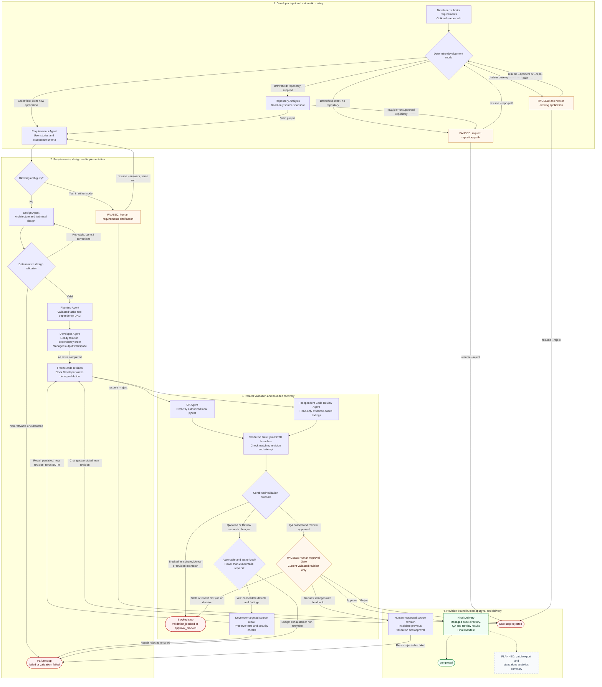

# End-to-end SDLC process

A developer supplies requirements to the existing LangGraph orchestrator. Explicit repository
input takes precedence over deterministic intent detection; no classification agent or extra
LLM call is used. Brownfield analysis precedes Requirements, while Greenfield starts directly
with Requirements.

The diagram shows the **implemented full workflow with `--stop-after delivery`**. The basic
`start --requirement` command defaults to stopping after Requirements. Other `--stop-after`
values preserve earlier stopping points. Solid paths are implemented; the dashed delivery
extension is planned and does not run today.



The two project-input pauses are different presentations of the same checkpointed
`project_input` node. Requirements clarification uses its own interrupt. The diagram groups
internal preparation, retry-counter and artifact-export nodes for readability. Agent errors
can stop earlier stages; a failed Requirements, Design or Planning stage cannot advance.
Developer task failures or budget exhaustion can pause at the existing development gate;
`resume --retry-development` retries within its existing limits, while `--reject` stops.

## Start and resume

Run from the repository root with the harness environment activated:

```bash
# Default target: Requirements only.
python run.py start --requirement "Build a URL shortener"

# Target the complete workflow, including the human approval gate.
python run.py start --requirement "Build a URL shortener using FastAPI and SQLite" --stop-after delivery

# Brownfield with an existing repository.
python run.py start --requirement "Add URL expiration" --repo-path ./existing-app --stop-after delivery

# Brownfield without a repository pauses before Requirements.
python run.py start --requirement "Add URL expiration to my existing URL shortener" --stop-after delivery
python run.py resume --run-id <run_id> --repo-path ./existing-app

# Answer the current intent or requirements question; retain the same run ID.
python run.py resume --run-id <run_id> --answers "Build a new application"
python run.py resume --run-id <run_id> --answers "Team members create and share short URLs"

# Cancel a project-input, requirements or development pause.
python run.py resume --run-id <run_id> --reject
```

Replace placeholders with the values printed by the CLI. Both interactive and noninteractive
runs return a paused result and instructions without blocking on stdin. Resume reopens
`workspace/runs/<run_id>/checkpoints.sqlite` with `thread_id = run_id`. Completed upstream
stages are reused; Requirements intentionally reruns with the recorded clarification answers.
The `scenarios/` Markdown files are acceptance examples, not runtime configuration.

Local QA requires developer-reviewed code and dependencies, a prepared dedicated Python 3.12
QA environment, and separate explicit authorization. A virtual environment is not a security
sandbox. A fresh full run therefore stops at `validation_blocked` if QA is not authorized.
After reviewing and preparing the code as described in the [QA instructions](../README.md):

```bash
# Rerun BOTH QA and Review, then request human approval if both pass.
python run.py qa --run-id <run_id> --authorize-local-execution --stop-after delivery

# Use the current revision in approval_request.json; decisions resume the approval interrupt.
python run.py decide --run-id <run_id> --revision <revision> --decision approve
python run.py decide --run-id <run_id> --revision <revision> --decision request_changes --feedback "Handle the documented edge case"
python run.py decide --run-id <run_id> --revision <revision> --decision reject
```

These three `decide` commands are alternatives for a pending approval. Human-requested changes
produce a new revision and require fresh QA, Review and approval. They do not reset the two
automatic-repair budget. Automatic repairs require actionable evidence and local execution
authorization; blocked execution and configuration errors are not blindly retried. Test edits
and weakened security checks are not allowed through the automatic repair path.

## State, evidence and delivery

| Capability | Implemented behavior |
| --- | --- |
| Run identity and restart | One run ID and persistent LangGraph state/checkpoints across human input, repairs and decisions. |
| Brownfield safety | Read-only bounded repository analysis; safe writer seeds and modifies `workspace/output_code/<run_id>/`, leaving the original repository unchanged. This managed copy is not an execution sandbox. |
| Parallel consistency | QA and Review consume the same frozen revision and write separate state fields; explicit fan-in waits for both. Revision or attempt mismatches block validation. |
| Execution evidence | `qa_results.json`, `review_results.json` and `validation_results.json` retain actual evidence and revision identifiers; a review summary alone cannot grant approval. Acceptance criteria remain `not_verified` without test-to-story evidence. |
| Delivery | Approved managed code directory, per-run requirements/design/plan and validation artifacts, approval history, and `final_manifest.json`. Delivery does not deploy or publish code. |
| Logs and metrics | Per-run `execution.log` and `events.jsonl` record stage durations, attempt numbers, transitions and recovery events; `recovery_history.json` records repairs when present. |
| Secret handling | Log metadata is allowlisted and redacted; raw requirements, model payloads and feedback are excluded from logs. QA subprocess secrets are filtered. Artifact files are not a blanket secret-redaction boundary. |
| Planned delivery exports | A patch bundle and standalone aggregated analytics summary are not implemented. Timing/retry events are available today; the final manifest does not contain an analytics summary. |

The Mermaid diagram describes the implemented full CLI route and explicitly marks the planned
exports. Earlier stop-after targets end at their selected stage, and `validation_passed` alone
never implies final human approval or completed delivery.
